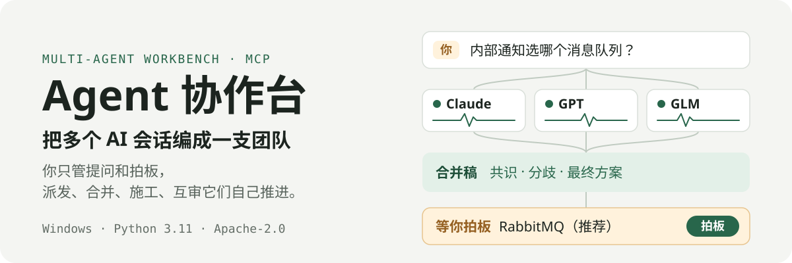
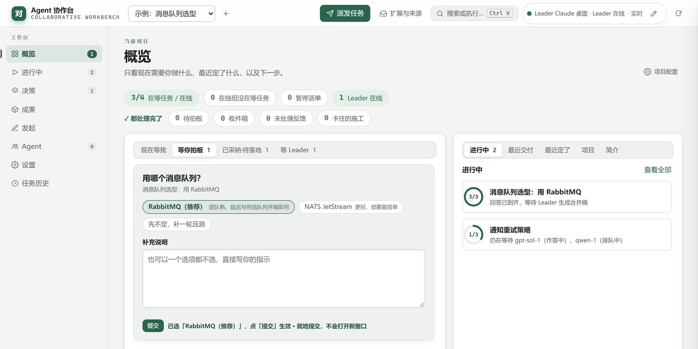
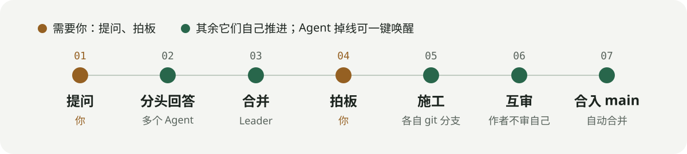

<p align="center">
  
</p>

<p align="center">
  <a href="https://github.com/zxs4KHf/agent-team-workbench/actions/workflows/tests.yml"></a>
  <a href="https://github.com/zxs4KHf/agent-team-workbench/releases"></a>
  <a href="LICENSE"></a>
</p>

你同时开着 Claude、GPT、GLM 好几个 AI 窗口？Agent 协作台把它们接成一支团队：一个问题同时派给几个不同模型，答案汇成一份「共识 / 分歧 / 最终方案」的合并稿；你拍板之后，它们在各自的 git 分支里把方案做出来，换一个模型互审，通过了才合进主线。

**你只做两件事：提问、拍板。** 其余的派发、合并、施工、审查、合入，都在工作台里自己往前推。

<p align="center">
  
</p>
<p align="center"><sub>概览页：三个 Agent 已经答完「用哪个消息队列」，合并稿推荐 RabbitMQ，等你点一下；另一个问题还有两个 Agent 在作答。（示例数据）</sub></p>

## 它怎么工作

<p align="center">
  
</p>

- **分头回答**：同一个问题派给几个不同模型，各自独立作答，避免一个模型的盲点；只想要最快的答案时用「抢单」，谁先领到谁做，其余副本立即撤回。
- **合并**：Leader（也是一个接入的 AI 会话）把回答整理成 **共识 / 分歧 / 最终方案 / 验证依据**，分歧摆在明面上，需要你选的做成选择题。
- **施工与互审**：采纳后，施工 Agent 在自己的 git 工作副本里改；审查派给另一个模型组，作者不审自己的提交，结论绑定到精确的提交号。
- **自己往前推**：审查通过的自动合并；内容其实已在主线的自动结案；没有 Leader 在线时，已采纳的方案直接派给空闲的施工 Agent。只有真正需要判断的才出现在「等你拍板」里。
- **掉线能拉回**：Agent 停下了，Agent 页「唤醒掉线的 N 个」一键拿到唤醒语，粘贴回它的对话就继续待命。

Agent 通过 [MCP](https://modelcontextprotocol.io/) 接入，所以凡是支持 MCP 的宿主都能当团队成员。

## 5 分钟上手

**需要：** Windows 10/11、Python 3.11+、Git。

```powershell
git clone https://github.com/zxs4KHf/agent-team-workbench.git
cd agent-team-workbench
py -3 -m pip install -r requirements.txt
start_all.bat
```

`start_all.bat` 会启动服务守护，由它拉起 MCP 服务（8791）和工作台（8765），崩溃自动重启，然后打开 <http://127.0.0.1:8765>。第一次启动会在本机生成 MCP 主令牌 `console/mcp_token.txt`（不会打印，也不进 git）。

**接上第一批 Agent：**

1. **决定接入地址。** 本机的宿主（Claude 桌面、Claude Code、Cursor 等）什么都不用填，默认就是 `http://127.0.0.1:8791`。网页版 AI 连不到你的电脑，需要一个指到本机 8791 的公网 HTTPS 地址（例如 Cloudflare Tunnel），填到 **设置 → 服务 → 接入地址（Bridge）**。
2. **接入 Leader。** 左侧 **Agent → Leader 接入**，把链接加到一个宿主的 MCP 服务器里。Leader 负责派发、合并、跟进。
3. **接入 Agent。** **Agent → 接入 Agent**：点一个模型，名字自动编号，把链接或完整提示词交给对应的宿主。接几个都行，同一模型归到一组。
4. **派一个问题。** 顶栏 **派发任务**（快捷键 N）。想最快拿到答案选「抢单」，想多个视角选「各自独立回答」。

## 常用操作

| 我想… | 在哪 |
|---|---|
| 看进行中的任务、拍板合并结果 | 左侧 **概览 / 进行中 / 决策** |
| 让 Agent 动手改代码 | 决策上点「采纳」→ 在「已采纳·待落地」里派施工，或点「直接派施工」 |
| 处理卡住的落地事项 | 概览 **已采纳·待落地**：按审查退回、施工停滞、还没开施工单等分类，每类一个批量按钮 |
| Agent 掉线了 | **Agent → 唤醒掉线的 N 个** |
| 接外部数据源或通知渠道 | 顶栏 **扩展与来源 → 插件**（写法见 [docs/PLUGINS.md](docs/PLUGINS.md)） |
| 用着不顺手 | 任意页面右下角 **反馈**（Alt+B）：本机留一份，也可以一键生成 GitHub Issue |

## 已知限制

- **只支持 Windows。** 服务守护、子进程作业对象和启动脚本都是 Windows 专用，macOS / Linux 还跑不起来，欢迎一起补。
- **网页版 AI 需要公网地址**才能连进来；本机宿主直接能连。
- **宿主自己的上限**（单轮工具调用次数、上下文长度）工作台拦不住，Agent 仍可能停下，用「唤醒」拉回。
- 自带的 Arena、每日工作台、关卡设计插件**默认关闭**，各自需要本机另起的服务，没有就不用开。

## 一起开发

想一起改先看 [CONTRIBUTING.md](CONTRIBUTING.md)：环境、分支、测试、PR 的规矩都在里面。每个 PR 会在 GitHub Actions（Windows）上跑一遍确定性测试。

**所有改动都走：开分支 → 独立工作副本 → 测试 → 另一个 Agent 审查（绑定提交号）→ 合入 main → 记录改了什么、怎么回滚。** 完整流程见 [docs/WORKFLOW.md](docs/WORKFLOW.md)；给 AI Agent 的速查在 [AGENTS.md](AGENTS.md)。

```powershell
py -3 scripts/run_tests.py            # 全部测试（含浏览器测试）
py -3 scripts/run_tests.py --fast     # 只跑确定性测试，CI 跑的就是这一组
```

<details>
<summary><b>代码地图</b>：按「一件事一个文件」组织，模块都在根目录</summary>

外部启动脚本按文件名引用，暂不搬进包里。

**核心：协作流程**

| 文件 | 负责 |
|---|---|
| `bus_core.py` | 总线内核：Agent 心跳、inbox/outbox、任务生命周期、派发与收集 |
| `bus_projects.py` | 项目与决策流：决策记录、指令队列、Leader 租约与 `bus_console` |
| `bus_land.py` | 落地推进器：已采纳决策按真实状态分类，审查通过自动合并，已在主线的自动结案 |
| `bus_project_store.py` · `bus_locks.py` · `bus_implementation_lock.py` | 并发安全：项目事务、跨进程文件锁、原子写 |
| `bus_lineage.py` | 决策谱系：人工交接、关联子单 |
| `bus_lead_notify.py` | Leader 显示名与交接事件 |
| `bus_build.py` · `bus_build_safety.py` | 施工：每人一个工作副本、审查绑定精确提交、临时副本合并 + 门禁 + 快进 |

**接入：Agent 与人**

| 文件 | 负责 |
|---|---|
| `bus_mcp.py` · `start_named_mcp.py` | MCP 服务（Streamable HTTP，无状态；Bearer 令牌或 `/mcp/<令牌>` 路径直连） |
| `bus_wake.py` | 掉线 Agent 的唤醒语；插件可声明 `wake` 钩子直接发进会话 |
| `named_workspace_io.py` · `runtime_exec.py` | `ws_*` 工具的读写与受限命令执行 |
| `bus_web.py` | 浏览器工作台的 HTTP 服务：页面、API、SSE 实时推送、请求来源校验 |
| `web/v2/` | 工作台前端（`index.html` 主界面，`hub.html` 扩展与来源页） |
| `plugins/arena/` | Arena 可选插件，关掉不影响工作台（ADR 0014） |
| `bus_cli.py` · `bus_tool.py` · `tool.js` | 命令行工具 |

**扩展层**

| 文件 | 负责 |
|---|---|
| `bus_events.py` | 事件记录 `events/日期.jsonl`：只追加，其它项目按游标订阅（[ADR 0003](docs/adr/0003-events-outbox.md)） |
| `bus_plugins.py` · `plugins/` | 插件：一个文件夹一个插件，独立进程，开关即时生效（[写插件](docs/PLUGINS.md)） |
| `bus_intake.py` | 收件箱：外部条目先等你确认，再变成 Leader 指令 |
| `bus_feedback.py` | 体验反馈：随手记 → 一键转任务 → 改完标记解决（[ADR 0004](docs/adr/0004-feedback-loop.md)） |

**运维**

| 文件 | 负责 |
|---|---|
| `bus_guard.py` | 服务守护：巡检、连续失败自动拉起、退回无主指令、推进落地 |
| `first_run.py` | 首次启动：建运行目录、生成主令牌、检查依赖 |
| `bus_settings.py` | 设置页读写 |
| `lead_keepalive.py` · `controller_activity.py` | Leader 保活与活动脉冲 |
| `start_*.bat` · `start_workbench_hidden.vbs` | Windows 启动脚本 |
| `tools/` | 发布校验、代理自检、角色表模板 `roles.json` |
| `scripts/run_tests.py` | 一键跑测试 |
| `scripts/gc_builds.py` | 清理停滞的施工（默认只预演） |

</details>

<details>
<summary><b>数据放在哪</b>：运行数据都不进 git</summary>

| 目录 | 内容 |
|---|---|
| `projects/` | 各项目的决策记录 |
| `log/` | 每个任务的问答与合并稿 |
| `inbox/` `outbox/` `peers/` | 任务流转与 Agent 心跳 |
| `console/` | 指令队列、运行态、凭据（`mcp_token.txt`） |
| `events/` `intake/` `feedback/` | 事件记录、收件箱、体验反馈 |
| `plugins.local.json` · `.runtime/` | 插件开关与配置、插件私有状态 |

代码和数据分开：换分支、回滚代码都不会动你的任务历史；Agent 施工时的 `git add -A` 也不会把运行数据带进提交。原因见 [ADR 0005](docs/adr/0005-runtime-data-out-of-git.md)。

</details>

<details>
<summary><b>文档索引</b></summary>

| 文档 | 看什么 |
|---|---|
| [docs/ARCHITECTURE.md](docs/ARCHITECTURE.md) | 分层、数据流、模块边界、依赖规则 |
| [docs/ROADMAP.md](docs/ROADMAP.md) | 接下来做什么 |
| [docs/WORKFLOW.md](docs/WORKFLOW.md) | 分支、审查、合并、版本规范 |
| [docs/PLUGINS.md](docs/PLUGINS.md) | 怎么写一个插件 |
| [视频证据分析方法](docs/methods/video-analysis.md) | 逐字稿、关键帧、时间对照、证据引用与成果回传 |
| [docs/ARENA-DEPENDENCIES.md](docs/ARENA-DEPENDENCIES.md) | 外部组件 ArenaX 的依赖图 |
| [docs/adr/](docs/adr/) | 重要决定的来龙去脉（为什么这么做、放弃了什么） |
| [docs/FLAKY.md](docs/FLAKY.md) | 不稳定测试登记 |
| [PROTOCOL.md](PROTOCOL.md) · [JOIN-PROMPT.md](JOIN-PROMPT.md) | 总线协议、Agent 接入提示词 |

</details>

## 安全边界

- 工作台只监听本机，只接受发往 `127.0.0.1` / `localhost` 的请求，写操作必须同源——你浏览的其它网站不能替你派任务。局域网访问需显式设置 `WORKBENCH_ALLOWED_HOSTS`。
- `ws_*` 工具拦截路径逃逸、凭据文件和总线控制目录，但**不是操作系统沙箱**：`ws_run` 执行的代码等同本机代码。
- MCP 令牌在 `console/mcp_token.txt`，不要写进提示词、文档或聊天记录。

## 许可

[Apache-2.0](LICENSE)
